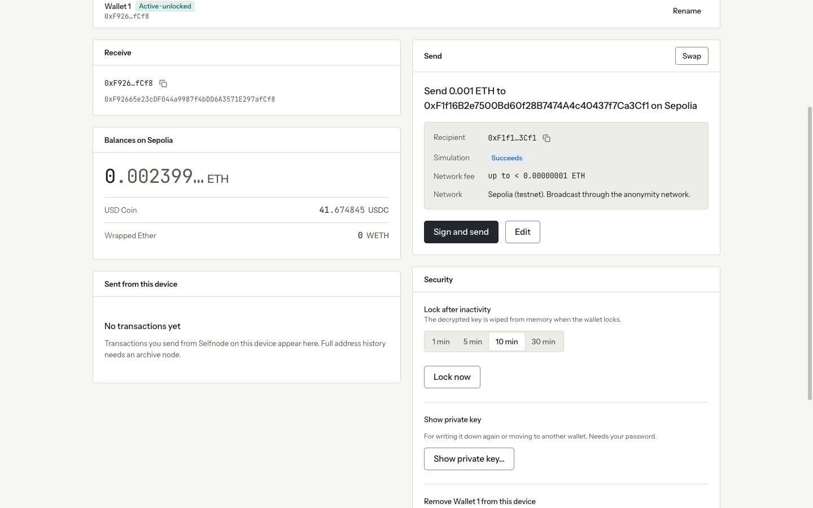
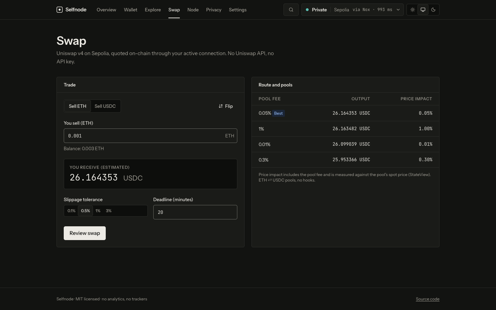
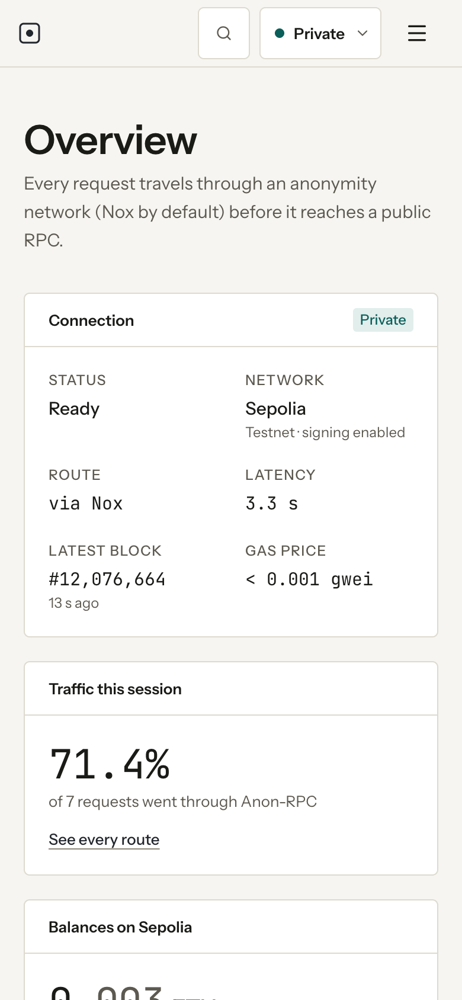
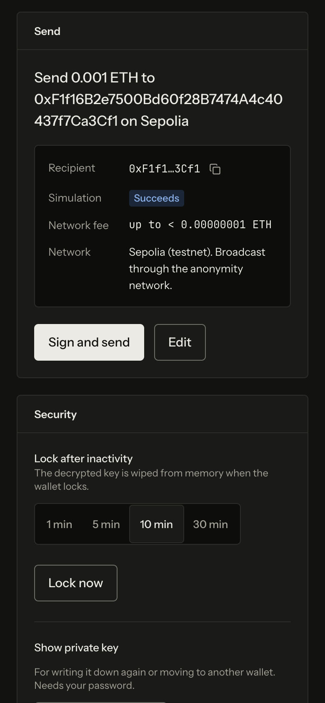
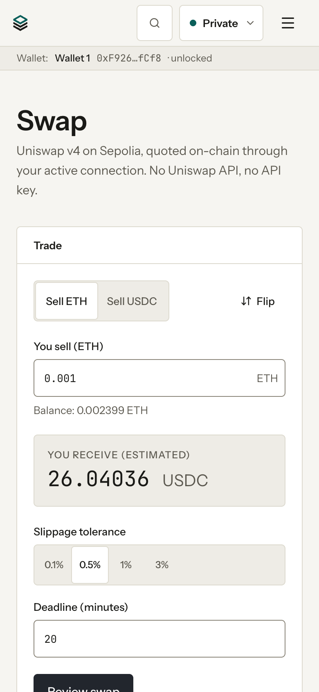
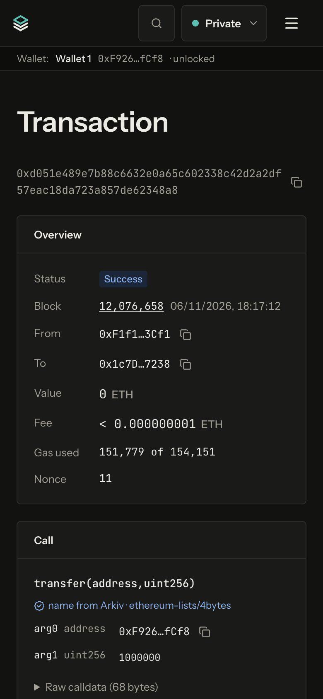

# Selfnode

**A private, verified Ethereum wallet, block explorer and swap app. Every request
goes through an anonymity network by default, so no RPC provider learns who you
are, and nothing depends on Infura's, Etherscan's or Uniswap's servers.**

**Live:** [selfnode.jhfe.workers.dev](https://selfnode.jhfe.workers.dev/) (Sepolia
wallet and swap; mainnet read-only). **Desktop:**
[v0.1.1-hackathon](https://github.com/ItsBreaker/selfnode/releases/tag/v0.1.1-hackathon)
(macOS and Windows, unsigned). **Swarm mirror:**
[bah5acgza24rt5fz….bzz.limo](https://bah5acgza24rt5fzsundf6gykleqgqmhtpzrmc2bd2fwx66hixe6z6wcdzura.bzz.limo/) (the same build, served from Swarm;
[details](arkiv/swarm.md#the-web-app-on-swarm)). Built at ETHGlobal Mumbai (November 2026).
MIT licensed.

## Screenshots

Live site, Private mode (every request through Nox), Sepolia.

| Wallet: plain-English preview before signing                             | Swap: Uniswap v4 quotes from the on-chain Quoter            |
| ------------------------------------------------------------------------ | ----------------------------------------------------------- |
|  |  |

<p>
  
  
  
  
</p>

All 16 (overview, wallet, swap and a decoded transaction; light and dark;
desktop and mobile) are in [`docs/screenshots/`](docs/screenshots/).

## What works today

| Feature                                                                                                                                                                                                                           | Status                                                                                   |
| --------------------------------------------------------------------------------------------------------------------------------------------------------------------------------------------------------------------------------- | ---------------------------------------------------------------------------------------- |
| **Private mode** (default): all reads and every broadcast go through [Anon-RPC](https://github.com/ethereum/anon-rpc) (Nox by default; Nym and Tor selectable)                                                                    | ✅ live, tested in-browser                                                               |
| **Verified mode**: [Helios](https://github.com/a16z/helios) light client checks answers against consensus (mainnet; Sepolia needs your own consensus endpoint)                                                                    | ✅ live                                                                                  |
| **My node mode**: reads from your own node; broadcasts still go through Anon-RPC                                                                                                                                                  | ✅ live                                                                                  |
| **Wallet**: create/import, scrypt + AES-GCM vault, auto-lock, multiple wallets and accounts from one phrase, Sepolia sends with a plain-English pre-sign preview, Max for ETH, Swap from the wallet, password-gated phrase reveal | ✅ live, end-to-end on Sepolia                                                           |
| **Explorer**: address, transaction and block views, ENS search, ⌘K, labels and function names from **Arkiv**                                                                                                                      | ✅ live                                                                                  |
| **Swap**: Uniswap v4 on Sepolia, quoted on-chain, Universal Router + Permit2                                                                                                                                                      | ✅ live, end-to-end on Sepolia                                                           |
| **Arkiv mirror**: open-licensed labels, scam list, tokens and function names, re-runnable importer                                                                                                                                | ✅ 3,349 entities on Rabdi (+3 snapshot pointers)                                        |
| **Data** page: browse the Arkiv mirror without a wallet (search, source + licence + commit per row, copy-paste query)                                                                                                             | ✅ live at [/data](https://selfnode.jhfe.workers.dev/data)                               |
| **Privacy report** page: what every third party learns, per mode                                                                                                                                                                  | ✅ live                                                                                  |
| **Desktop app** (Electron, `app://`): same UI plus a node manager that downloads, verifies and runs a pruned Sepolia node (Nethermind + Nimbus)                                                                                   | ✅ macOS Apple Silicon and Windows x64 (graceful shutdown tested in CI); unsigned builds |
| **Swarm snapshots** of the mirrored datasets, referenced from Arkiv (`swarmRef` + SHA-256), and `--from-swarm` rebuild ([swarm.md](arkiv/swarm.md))                                                                               | ✅ 3 snapshots via the bzz.limo public gateway; opt-in in-app archive                    |

Signing is **Sepolia-only** in this build. Mainnet is read-only, and that's
enforced in [`signer.ts`](packages/core/src/wallet/signer.ts) with tests.

## Run it

```sh
pnpm install
pnpm --filter @selfnode/web dev      # http://localhost:5173
pnpm check                           # typecheck, lint, format, tests
```

Node 26 and pnpm 12. No API keys are needed to run the app. Optional scripts read
keys from a local `.env` (see [`.env.example`](.env.example)).

## Desktop app and node manager

The same UI, served from `app://selfnode` with the website's security headers,
in a sandboxed, context-isolated Electron window. The Node page adds a node
manager for a **pruned Sepolia node: Nethermind (execution) + Nimbus
(consensus)**. Both are **minority clients**, a deliberate choice that supports
Ethereum's client diversity.

- **Verified binaries only.** Downloads come from the official GitHub releases
  pinned in [`apps/desktop/node-manifest.json`](apps/desktop/node-manifest.json).
  The archive's SHA-256 must match, and Nimbus's binary must also match the
  SHA-512 in its release notes. The installed files are re-hashed before every
  start. Nothing updates automatically.
  The manifest was reviewed by the maintainer. **Planned improvement:** Nethermind
  also publishes GPG signatures (`.asc`) for each build. Verifying them, in
  addition to the pinned checksums, isn't done yet. Nimbus doesn't publish
  signatures, which is why we also check its SHA-512s.
- **Smallest footprint.** Nethermind skips historical bodies and receipts and
  prunes history and state; Nimbus checkpoint-syncs without backfill and prunes
  history. Each flag is cited in
  [`node/args.ts`](apps/desktop/src/node/args.ts).
- **Disk safety.** The pre-flight check uses the clients' own published figures
  (Sepolia ≈ 212 GB execution + 200 GB consensus, plus four weeks of growth). It
  refuses to start without the larger of 50 GB or 10% free left over, and a
  watchdog pauses the node cleanly below that. You can pick the data directory
  (e.g. an external SSD).
- **Laptop-friendly.** It pauses on battery (optional) and stops cleanly on quit.
  RPC, Engine API and REST listen on 127.0.0.1 only, UPnP and NAT-PMP are off,
  and logs are in the app.
- **Reads switch to your node** once it's synced. Transactions are still broadcast
  through Anon-RPC.
- Intel Macs can run the app but not the node manager: neither Nimbus nor
  Lighthouse publishes an Intel macOS build.
- **Tested in CI on Windows; graceful shutdown verified.** Stopping sends each
  client a real console Ctrl+C (built-in PowerShell and Win32 calls, no extra
  binaries) and waits up to 60 s before any force-kill, which is logged. Damaged
  databases are detected and offer a confirmed resync from checkpoint. The
  [node shutdown workflow](.github/workflows/node-shutdown.yml) runs both clients
  on Windows and macOS and asserts a clean exit every time.

**Download:
[v0.1.1-hackathon pre-release](https://github.com/ItsBreaker/selfnode/releases/tag/v0.1.1-hackathon)**:
universal macOS `.dmg` and Windows `.exe`, unsigned, with `SHA256SUMS.txt` and
instructions for opening unsigned apps. Builds come from
[the desktop workflow](.github/workflows/desktop.yml). Run locally with
`pnpm --filter @selfnode/desktop start`.

## Deploy

Live at **https://selfnode.jhfe.workers.dev/**. It's a Cloudflare Worker with static assets; the only code is a few lines in [`apps/web/worker.js`](apps/web/worker.js), which runs for `/assets/*` alone and returns a real 404 for files from an old build (so an open tab reloads onto the new one), with no app logic and no logging
([`apps/web/wrangler.jsonc`](apps/web/wrangler.jsonc)), with security headers in
[`apps/web/public/_headers`](apps/web/public/_headers):

- A strict CSP: no `'unsafe-inline'` and no `'unsafe-eval'`, only
  `'wasm-unsafe-eval'`. `frame-ancestors 'none'`, `nosniff`,
  `Referrer-Policy: no-referrer`, a locked-down `Permissions-Policy`, and COOP.
- The Anon-RPC sandbox page is self-hosted with its own tighter policy, so the
  harness never needs an inline script.

Tested with `pnpm --filter @selfnode/web preview:cf` (`wrangler dev` on the
production build), and again on the live site: Nox, Nym, Helios (WASM), Arkiv
labels and the full wallet-and-swap flow all ran with zero CSP violations.
Deploy with `pnpm --filter @selfnode/web deploy:cf`.

## Anon-RPC: private by default

- One long-lived `AnonRpcWorker` per anonymity network; its `fetch` is passed to
  viem's HTTP transport (`fetchFn`) in
  [`transport/router.ts`](packages/core/src/transport/router.ts) and
  [`transport/anon-pool.ts`](packages/core/src/transport/anon-pool.ts).
- **Every** feature (wallet, explorer, swap, and Arkiv label lookups) gets its
  transport from that one router. It counts every JSON-RPC call by route, and it
  **never falls back to a direct connection on its own**: a failure is shown as a
  failure. A direct request only happens when the user approves it for one
  action, and the connection indicator then turns amber and counts it.
- `eth_sendRawTransaction` always goes through Anon-RPC, **in every mode**. A node,
  or Helios's upstream, broadcasting directly would reveal your IP.
- Measured worker performance (Phase 0, [`docs/DECISIONS.md`](docs/DECISIONS.md)):
  Nox ready in about 3.5 s, then about 1–3 s per request; Nym ready in 8–16 s.
  Tor's public demo gateway was unreachable.

### Traffic share

In a scripted end-to-end session against the **production build, served with the
production security headers** (create a wallet, receive funds, then swap ETH →
USDC and USDC → ETH through Permit2), **97 of 99 JSON-RPC calls (98.0%) went
through Anon-RPC**. The other 2 were the disclosed bootstrap reads. **0** went
direct. Settings → Traffic shows the live counter, by route, for the session and
all time.

Every exception, and why:

| Route                                | Why it isn't anonymised                                                                                                                                                                                                                                                                                                                             |
| ------------------------------------ | --------------------------------------------------------------------------------------------------------------------------------------------------------------------------------------------------------------------------------------------------------------------------------------------------------------------------------------------------- |
| Bootstrap read                       | Starting an anonymity network needs one read of its on-chain specifier (worker hash and resolvers) before the network exists. 2 calls per session. In My node mode it goes to your own node instead (when it's on the specifier's chain: Sepolia for Nox). The worker hash is pinned per network; a change stops and asks before the new code runs. |
| Helios upstream (Verified mode only) | Helios accepts URLs, not a `fetch` function, so it can't use Anon-RPC. It's a separate mode the user chooses, labelled "Helios · direct".                                                                                                                                                                                                           |
| Your node (My node mode only)        | Reads go to your own node. Broadcasts still use Anon-RPC.                                                                                                                                                                                                                                                                                           |
| Direct, approved by you              | A one-off request the user explicitly confirmed, counted separately.                                                                                                                                                                                                                                                                                |
| Swarm archive (opt-in)               | Only if the user clicks "Load labels from the Swarm archive": three public snapshot files from the bzz.limo gateway, SHA-256-checked against Arkiv. Plain downloads, not RPC, so not in the counter.                                                                                                                                                |

## CROPS

**Censorship resistance**

- No Selfnode backend. The web app is static files, and every read and write goes
  to public infrastructure that you choose: public RPCs through an anonymity
  network, a Helios upstream, or your own node.
- Labels, tokens and function names come from Arkiv, a public store anyone can
  read without permission, not from an API we could switch off.
- The anonymity network, RPC endpoints, Tor gateway and Helios endpoints are all
  user-configurable.
- **Dependencies we still rely on, and how to replace each:**
  - The default public RPC (PublicNode): choose another, or use My node.
  - The anonymity network's operators: choose Nox, Nym or Tor.
  - The Arkiv testnet: anyone can re-run the importer under their own owner address.
  - The web host: serve the static build yourself.

**Open source**

- MIT licence. Pinned exact dependency versions with a committed lockfile.
- Dependency install scripts are blocked except `esbuild`, and pnpm's
  minimum-release-age policy applies with no exceptions.
- CI runs typecheck, lint, format, 168 tests and gitleaks on every push, plus macOS and Windows desktop builds.
- Builds with `pnpm install && pnpm --filter @selfnode/web build`.

**Privacy**

- Private mode hides your IP from RPC providers. The full table of what each
  party learns, in each mode, is on the in-app Privacy page
  ([`content/privacy.ts`](apps/web/src/content/privacy.ts)).
- What it doesn't hide:
  - The RPC provider still sees request contents.
  - The anonymity network's worker sees your requests.
  - The bootstrap read is direct.
  - Verified mode is direct to its upstreams.
  - The Swarm archive download, if you choose to load it, is direct to the
    gateway.
- No analytics, trackers, error reporting, or remote fonts or scripts. Fonts are
  self-hosted from npm.

**Security**

- Keys are generated and kept on the device. The vault is scrypt (N=2¹⁷, r=8,
  p=1) → AES-GCM with a random salt and IV. Version, address and KDF parameters
  are authenticated, so tampering fails decryption
  ([`wallet/vault.ts`](packages/core/src/wallet/vault.ts)).
- The decrypted key is held as bytes and zeroed on lock, after inactivity, or on
  page hide.
- One small signing module enforces **testnet-only** signing for transactions
  and typed data, refuses a missing chain ID, and offers no `personal_sign`
  ([`wallet/signer.ts`](packages/core/src/wallet/signer.ts), with tests).
- Every send and swap is simulated and shown in plain English before signing,
  with warnings for flagged recipients (from Arkiv), the zero address, token
  contracts, high price impact and high slippage.
- Token approvals for swaps are for the exact amount, never unlimited.

## Uniswap v4 (Sepolia)

No Uniswap API and no SDK: quoting is `eth_call` to the v4 Quoter through the
active (anonymised) transport, and execution is hand-encoded Universal Router
calldata, using viem only.

| What                                                                                          | Where                                                                                                                         |
| --------------------------------------------------------------------------------------------- | ----------------------------------------------------------------------------------------------------------------------------- |
| Deployment addresses (from Uniswap's docs) and the pinned router struct layout                | [`config/uniswap.ts` L14–L37](packages/core/src/config/uniswap.ts#L14-L37)                                                    |
| **Quoter call**: `quoteExactInputSingle` for every standard tier, plus StateView price impact | [`swap/quote.ts` L94–L147](packages/core/src/swap/quote.ts#L94-L147) (ABI [L21–L43](packages/core/src/swap/quote.ts#L21-L43)) |
| **Universal Router calldata**: command and action constants                                   | [`swap/v4.ts` L23–L32](packages/core/src/swap/v4.ts#L23-L32)                                                                  |
| `ExactInputSingleParams` (both layouts)                                                       | [`swap/v4.ts` L86–L129](packages/core/src/swap/v4.ts#L86-L129)                                                                |
| `V4_SWAP` = `SWAP_EXACT_IN_SINGLE` + `SETTLE_ALL` + `TAKE_ALL`                                | [`swap/v4.ts` L131–L149](packages/core/src/swap/v4.ts#L131-L149)                                                              |
| `execute(commands, inputs, deadline)`                                                         | [`swap/v4.ts` L215–L221](packages/core/src/swap/v4.ts#L215-L221)                                                              |
| Building the swap call with slippage and an optional permit                                   | [`swap/build.ts` L98–L132](packages/core/src/swap/build.ts#L98-L132)                                                          |
| **Permit2 flow**: allowance checks (ERC-20 → Permit2, Permit2 → router)                       | [`swap/build.ts` L47–L75](packages/core/src/swap/build.ts#L47-L75)                                                            |
| `PermitSingle` for the exact amount                                                           | [`swap/build.ts` L77–L89](packages/core/src/swap/build.ts#L77-L89)                                                            |
| EIP-712 typed data and `PERMIT2_PERMIT` input                                                 | [`swap/v4.ts` L172–L198](packages/core/src/swap/v4.ts#L172-L198)                                                              |
| Approve → sign permit → simulate, in the UI                                                   | [`pages/Swap.tsx` L182–L279](apps/web/src/pages/Swap.tsx#L182-L279)                                                           |
| Pre-sign checks (impact, slippage, balance, simulation)                                       | [`swap/build.ts` L140–L182](packages/core/src/swap/build.ts#L140-L182)                                                        |
| Testnet-only typed-data signing                                                               | [`wallet/signer.ts` L64–L71](packages/core/src/wallet/signer.ts#L64-L71)                                                      |

Verified on Sepolia from the browser, through Nox: ETH → USDC
[`0x140aadf8…6a9e`](https://sepolia.etherscan.io/tx/0x140aadf85708e32413dd9d719b0128cb0ebfdf7c8bde845b58b0ad1553e86a9e),
USDC → ETH via Permit2
[`0x872b65f1…cdcf`](https://sepolia.etherscan.io/tx/0x872b65f1234465a379af7ec85ba04c98dfef1f2f5c76352eee88879a41a8cdcf).

Developer feedback for Uniswap: **[FEEDBACK.md](FEEDBACK.md)**.

## Arkiv: mirroring what Ethereum wallets depend on

Selfnode mirrors open-licensed address labels, MyEtherWallet's scam list, token
metadata and function signatures into **Arkiv's Rabdi testnet (chain ID 7794095)**. The app reads them (through Anon-RPC) to label every address, warn
about flagged recipients before you sign, and decode calldata.

- **Writer wallet (owner of every entity):**
  [`0xA05A5c06d69dECa38FdB779957d4E7B3aC2B8c39`](https://rabdi.explorer.arkiv.network/address/0xA05A5c06d69dECa38FdB779957d4E7B3aC2B8c39)
- **Contents:** 2,105 tokens, 796 labels (144 contracts and 652 flagged
  addresses), 444 function signatures (covering 68.4% of calls in a 300-block
  mainnet sample), and 4 licence-notice entities: 3,349 at the first import. The
  daily refresh re-samples usage, so the function-name set moves (462 current,
  covering 72.6%, after the first refresh; older ones expire). Plus 4
  `selfnode-snapshot` entities (3 dataset snapshots and the web app's Swarm
  mirror).
- **Importer:** [`scripts/arkiv-mirror/`](scripts/arkiv-mirror/). It's
  idempotent: it creates, patches, extends near expiry, or skips by a
  deterministic key. It guards a tGLM reserve. Run it with
  `pnpm --filter @selfnode/scripts arkiv:mirror [--dry-run]`. **Refreshed
  daily** by [`.github/workflows/arkiv-mirror.yml`](https://github.com/ItsBreaker/selfnode/actions/workflows/arkiv-mirror.yml).
- **Browse it:** the public **Data page**, [selfnode.jhfe.workers.dev/data](https://selfnode.jhfe.workers.dev/data): tokens by symbol or
  address, labels by name, category or address, function names by selector or
  text, each with source, licence and commit, plus a copy-paste query.
- **Swarm snapshots:** each dataset is also one unencrypted JSON file on Swarm,
  pointed to by a `selfnode-snapshot` entity (`swarmRef`, `sha256`). `--snapshot`
  uploads them; `--from-swarm` rebuilds Arkiv from them after verifying the
  hash. In the app, Settings → "Load labels from the Swarm archive" (opt-in;
  the gateway sees your IP) loads them in one go, checked against Arkiv.
  Details, references and friction: [swarm.md](arkiv/swarm.md).
- **Docs:** [schema](arkiv/schema.md) · [data quality](arkiv/data-quality.md) ·
  [reach](arkiv/reach.md) · [why Arkiv](arkiv/why-arkiv.md) ·
  [friction](arkiv/friction.md) · [Swarm](arkiv/swarm.md)

**A runnable query** (no key needed). The full script is in
[`arkiv/examples/query.ts`](arkiv/examples/query.ts):

```ts
import { createPublicClient } from "@arkiv-network/sdk";
import { rabdi } from "@arkiv-network/sdk/chains";
import { and, eq } from "@arkiv-network/sdk/query";
import { http } from "viem";

const arkiv = createPublicClient({ chain: rabdi({ accessKey: "" }), transport: http() });
const { entities } = await arkiv
  .select({ name: true, category: true, note: true, source: true })
  .where(
    and(
      eq("type", "label"),
      eq("chain", "1"),
      eq("address", "0x09750ad360fdb7a2ee23669c4503c974d86d8694"),
    ),
  )
  .ownedBy("0xA05A5c06d69dECa38FdB779957d4E7B3aC2B8c39")
  .fetch();
// → "Flagged by MyEtherWallet's list", category "flagged", with the list's note
```

### Data sources and licences

All three sources are MIT. Every entity records its `source`, `license` and
exact `sourceCommit`, and the full licence text is stored on Arkiv itself (one
`selfnode-dataset` entity per source) and in [`arkiv/licenses/`](arkiv/licenses/).
**No Sourcify data is used.**

| Data                                      | Source                                                                                                                        | Licence notice                                      |
| ----------------------------------------- | ----------------------------------------------------------------------------------------------------------------------------- | --------------------------------------------------- |
| Address labels, scam list, Sepolia tokens | [MyEtherWallet/ethereum-lists](https://github.com/MyEtherWallet/ethereum-lists/tree/8f86cba9b58db79608ece8fa784775b3c41e2e26) | MIT License, Copyright (c) 2020 MyEtherWallet       |
| Mainnet tokens                            | [ethereum-lists/tokens](https://github.com/ethereum-lists/tokens/tree/55622d80c18cc5cabaa8cb9a4c4214daaa9cf05e)               | MIT License, Copyright (c) 2018 ethereum-lists      |
| Function signatures                       | [ethereum-lists/4bytes](https://github.com/ethereum-lists/4bytes/tree/2b8a705fe27833b59aac2a2af5d14e0144e1e56e)               | MIT License, Copyright (c) 2018 Ethereum-Lists Team |

Flagged addresses are always shown as "Flagged by MyEtherWallet's list", with the
source and a reminder that lists can include mistakes, never as a flat "scam".

## Architecture

```
packages/core/       framework-agnostic TypeScript
  src/brand.ts       product name and links (single source of truth)
  src/config/        chains, RPCs, Anon-RPC specifiers, Uniswap and Arkiv addresses (each with its source)
  src/transport/     mode router, Anon-RPC worker pool, Helios, traffic and health tracking
  src/wallet/        keys, vault, session, signer (testnet guard), send preview
  src/labels/        Arkiv schemas, mirror reader, Data-page browsing, Swarm archive (opt-in), calldata decoding
  src/swap/          Uniswap v4 encoding, quoting, Permit2, swap checks
apps/web/            React + Vite UI
apps/desktop/        Electron shell (app://), node manager, node-manifest.json
scripts/             Arkiv mirror (+ Swarm snapshots, --from-swarm), key generation, Sepolia funding helper, Phase 0 spikes
arkiv/               Arkiv and Swarm prize docs, licence texts, query and Swarm read examples
docs/                DECISIONS.md, SUBMISSION_CHECKLIST.md, DEMO_SCRIPT.md, brand/ (logo), screenshots/
```

## AI use

Selfnode was built during the hackathon with **Claude Code** (Anthropic), working
with a human developer who set direction, approved every dependency and data
source, and reviewed the results. Claude Code wrote most of the code and docs,
ran the Phase 0 feasibility spikes, and verified behaviour end to end in a
headless browser and on Sepolia. Commits made with it carry a
`Co-Authored-By: Claude` trailer. Decisions and trade-offs are logged in
[`docs/DECISIONS.md`](docs/DECISIONS.md).

## Licence

[MIT](LICENSE). Mirrored data keeps its own MIT notices (see above).
